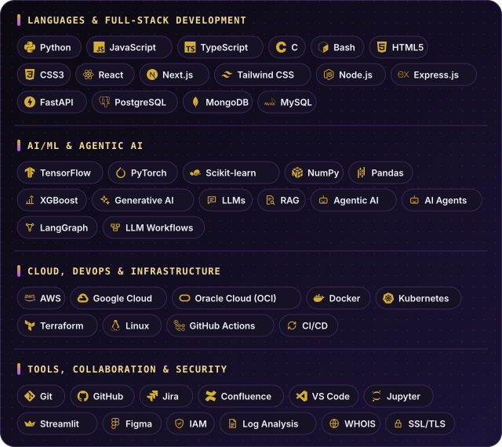

<div align="center">
  
</div>

<br>

<div align="center">
  
</div>

<p align="center">
  <a href="https://jass-pvt.github.io/jr-portfolio/"><b>Portfolio</b></a> &nbsp;◆&nbsp;
  <a href="https://www.linkedin.com/in/jaswanthrathore/"><b>LinkedIn</b></a> &nbsp;◆&nbsp;
  <a href="mailto:rathoresjaswanth@gmail.com"><b>Email</b></a> &nbsp;◆&nbsp;
  <a href="https://github.com/Jass-pvt?tab=repositories"><b>All repositories</b></a>
</p>

<!--
  MAINTENANCE
  • Every assets/ui-*.svg is generated by tools/generate_assets.py (edit the DATA block, run it, commit).
  • assets/jaswanth-hero.svg and assets/jaswanth-footer.svg are hand-made. The script never touches them.
  • Each project is ONE single-cell table: banner image + description. Copy a block to add a project.
-->

<br>

<div align="center"></div>

<br>

<p align="center">
I'm a Software Engineer focused on full-stack development, AI/ML, cloud computing, and DevOps. I enjoy building scalable applications, developing intelligent systems, and automating workflows to solve real-world problems through clean, efficient, and reliable code.
</p>

<div align="center">
  
</div>

<br>

<table width="100%">
  <tr>
    <td width="60%" valign="top">

```python
class JaswanthRathore:

    def __init__(self):
        self.name = "Jaswanth Rathore"
        self.role = "Software Engineer"
        self.location = "Chennai, India 🇮🇳"

    @property
    def skills(self):
    return {
        "languages": ["Python 🐍", "JavaScript", "TypeScript", "HTML/CSS"],
        "frontend": ["React", "Next.js", "Tailwind CSS"],
        "backend_db": ["Node.js", "Express.js", "FastAPI", "PostgreSQL", "MongoDB", "MySQL"],
        "ai_ml": ["Scikit-learn", "Pandas", "NumPy", "LLMs", "RAG", "LangGraph"],
        "cloud_devops": ["AWS ☁️", "Docker", "Terraform", "GitHub Actions", "Linux"],
        "tools": ["Git", "GitHub", "VS Code", "Jupyter", "Streamlit"]
    }

    def current_focus(self):
        return [
            "🔭 Building Full-Stack + IoT Projects",
            "📖 Sharpening DSA & System Design",
            "🛡️ Deepening Cybersecurity Knowledge",
            "☁️ Exploring AWS & GCP Services",
        ]
```

</td>
    <td width="40%" align="center" valign="middle">
      
      <br><br>
      
      
    </td>
  </tr>
</table>

<br>

<div align="center"></div>

<br>

<div align="center">
  
</div>

<br>

<div align="center"></div>

<br>

<table width="100%">
  <tr>
    <td valign="top">
      <a href="https://github.com/Jass-pvt/PhishGuard-AI"></a>
      <p>AI-powered phishing URL detection with <b>explainable results</b>. Paste a URL and get a verdict (safe / suspicious / phishing), a probability, a risk level, and the factors behind the score, then keep the scan in your history. Optional external threat-intelligence lookups are shown separately from the ML prediction, so one never masks the other.</p>
      <ul>
        <li><b>XGBoost</b> classifier trained on 31 lexical, domain, and security features</li>
        <li><b>SHAP</b> explanations translated into plain language ("raises risk / lowers risk")</li>
        <li>Google OAuth 2.0 sign-in, scan history, and a risk dashboard</li>
      </ul>
      <p><code>Python</code> <code>FastAPI</code> <code>React</code> <code>TypeScript</code> <code>XGBoost</code> <code>SHAP</code> &nbsp;·&nbsp; <a href="https://github.com/Jass-pvt/PhishGuard-AI"><b>View repository →</b></a></p>
    </td>
  </tr>
</table>

<br>

<table width="100%">
  <tr>
    <td valign="top">
      <a href="https://github.com/Jass-pvt/talentlens-ai"></a>
      <p>Backend CLI that screens ~50 PDF resumes for an AI/Python internship. Deterministic eligibility rules, a 100-point scoring model with <b>visible evidence</b> for every score, and enrichment from public GitHub data, written out as a ranked JSON file.</p>
      <p><code>Python</code> <code>Rule-based eligibility</code> <code>Evidence scoring</code> <code>GitHub enrichment</code> &nbsp;·&nbsp; <a href="https://github.com/Jass-pvt/talentlens-ai"><b>View repository →</b></a></p>
    </td>
  </tr>
</table>

<br>

<table width="100%">
  <tr>
    <td valign="top">
      <a href="https://github.com/Jass-pvt/Smart-Garden-IoT-System"></a>
      <p>End-to-end plant monitoring and automated irrigation. An <b>ESP32</b> streams soil moisture and humidity to <b>Firebase</b>; a <b>React Native</b> app shows live values and switches the water pump between auto and manual mode.</p>
      <p><code>ESP32</code> <code>Firebase Realtime DB</code> <code>React Native</code> <code>JavaScript</code> &nbsp;·&nbsp; <a href="https://github.com/Jass-pvt/Smart-Garden-IoT-System"><b>View repository →</b></a> &nbsp;·&nbsp; <a href="https://snack.expo.dev/@jaswanthrathore/smart-garden-iot-system">Live app</a></p>
    </td>
  </tr>
</table>

<br>

<table width="100%">
  <tr>
    <td valign="top">
      <a href="https://github.com/Jass-pvt/url_safety_check.py"></a>
      <p>Python tool that scores a URL's safety with layered checks: phishing heuristics, SSL/TLS certificate validation, WHOIS domain age, and page-content analysis, with optional VirusTotal and Google Safe Browsing lookups.</p>
      <p><code>Python</code> <code>SSL/TLS</code> <code>WHOIS</code> <code>VirusTotal API</code> &nbsp;·&nbsp; <a href="https://github.com/Jass-pvt/url_safety_check.py"><b>View repository →</b></a></p>
    </td>
  </tr>
</table>

<br>

<p align="center"><b>More from the lab</b></p>

- [**ml-spam-email-classifier**](https://github.com/Jass-pvt/ml-spam-email-classifier) — preprocessing, EDA, multiple models, and ensembles for spam detection · `Python` `Scikit-learn` `NLTK` `Streamlit`
- [**learning-activity-analytics**](https://github.com/Jass-pvt/learning-activity-analytics) — dated snapshots of my public Google Skills, LeetCode, and GeeksforGeeks profiles · `Python`
- [**F1_analysis.R**](https://github.com/Jass-pvt/F1_analysis.R) — Random Forest model predicting F1 driver performance from simulated race data · `R`
- [**synthetic-resume-generator**](https://github.com/Jass-pvt/synthetic-resume-generator) — controlled synthetic resume PDFs for testing TalentLens without real candidate data · `Python`
- [**Budget-Tracker**](https://github.com/Jass-pvt/Budget-Tracker) — personal finance and budget tracking project · `JavaScript`
- [**jr-portfolio**](https://github.com/Jass-pvt/jr-portfolio) — my portfolio site · `HTML` · [live](https://jass-pvt.github.io/jr-portfolio/)

<br>

<div align="center"></div>

<br>

<!-- Widgets are third-party services. If one stops loading, delete just that . -->

<table width="100%">
  <tr>
    <td width="50%" align="center" valign="top">
      
    </td>
    <td width="50%" align="center" valign="top">
      
    </td>
  </tr>
  <tr>
    <td width="50%" align="center" valign="top">
      
    </td>
    <td width="50%" align="center" valign="top">
      
    </td>
  </tr>
  <tr>
    <td colspan="2" align="center">
      
    </td>
  </tr>
</table>

<br>

<div align="center"></div>

<br>

<div align="center">
  
  <br><br>
  
</div>

<p align="center">
  <br>
  <a href="https://github.com/pulls?q=is%3Apr+author%3AJass-pvt+-user%3AJass-pvt"><b>Browse my pull requests to other repositories →</b></a>
</p>

<br>

<div align="center"></div>

<br>

<!-- Inline images (no table) so the buttons wrap to one per line on phones. -->
<p align="center">
  <a href="https://www.linkedin.com/in/jaswanthrathore/"></a>
  <a href="mailto:rathoresjaswanth@gmail.com"></a>
  <a href="https://jass-pvt.github.io/jr-portfolio/"></a>
</p>
<p align="center">
  <a href="https://leetcode.com/u/JaswanthRathore/"></a>
  <a href="https://www.hackerrank.com/profile/rathoresjaswanth"></a>
  <a href="https://www.skills.google/public_profiles/def4bf30-fead-4bf0-81b4-d1c68bcbb7bc"></a>
</p>

<br>

<div align="center">
  
</div>

<br>

<div align="center">
  
</div>
