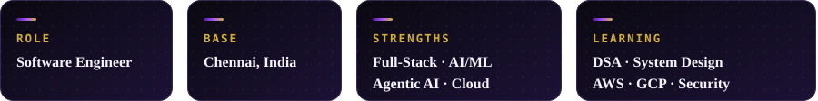

<div align="center">
  
</div>

<br>

<div align="center">
  
</div>

<p align="center">
  <a href="https://jass-pvt.github.io/jr-portfolio/"><b>Portfolio</b></a> &nbsp;◆&nbsp;
  <a href="https://www.linkedin.com/in/jaswanthrathore/"><b>LinkedIn</b></a> &nbsp;◆&nbsp;
  <a href="mailto:rathoresjaswanth@gmail.com"><b>Email</b></a> &nbsp;◆&nbsp;
  <a href="https://github.com/Jass-pvt?tab=repositories"><b>All repositories</b></a>
</p>

<!--
  MAINTENANCE
  • Every assets/ui-*.svg is generated by tools/generate_assets.py (edit the DATA block, run it, commit).
  • assets/jaswanth-hero.svg and assets/jaswanth-footer.svg are hand-made and never touched by the script.
  • Project text lives below as plain Markdown/HTML, so it stays selectable and easy to edit.
-->

<br>

<div align="center"></div>

<br>

<p align="center">
  I'm a software engineer in Chennai who likes projects that cross layers:<br>
  a FastAPI service, an ML model that explains its own verdicts,<br>
  an ESP32 talking to a mobile app through the cloud.<br>
  My work sits where full-stack engineering meets AI/ML, cloud, and security.
</p>

<div align="center">
  
</div>

<br>

<table>
  <tr>
    <td width="60%" valign="top">

```python
class JaswanthRathore:

    def __init__(self):
        self.name = "Jaswanth Rathore"
        self.role = "Software Engineer"
        self.location = "Chennai, India 🇮🇳"

    @property
    def skills(self):
        return {
            "languages": [
                "Python 🐍", "R", "JavaScript", "HTML/CSS"
            ],
            "ml": [
                "Scikit-learn", "NumPy", "Pandas", "NLTK"
            ],
            "cloud": [
                "AWS ☁️", "Google Cloud", "Oracle OCI"
            ],
            "security": [
                "IAM", "Log Analysis", "WHOIS", "SSL/TLS"
            ],
            "tools": [
                "Git", "VS Code", "Jupyter", "Streamlit"
            ],
            "databases": [
                "MongoDB", "MySQL", "Firebase"
            ],
        }

    def current_focus(self):
        return [
            "🔭 Building Full-Stack + IoT Projects",
            "📖 Sharpening DSA & System Design",
            "🛡️ Deepening Cybersecurity Knowledge",
            "☁️ Exploring AWS & GCP Services",
        ]
```

</td>
    <td width="40%" align="center" valign="middle">
      
      <br><br>
      
      
    </td>
  </tr>
</table>

<br>

<div align="center"></div>

<br>

<div align="center">
  
</div>

<br>

<div align="center"></div>

<br>

<a href="https://github.com/Jass-pvt/PhishGuard-AI"></a>

AI-powered phishing URL detection with **explainable results**. Paste a URL and get a verdict (safe / suspicious / phishing), a probability, a risk level, and the factors behind the score, then keep the scan in your history. Optional external threat-intelligence lookups are shown separately from the ML prediction, so one never masks the other.

- **XGBoost** classifier trained on 31 lexical, domain, and security features
- **SHAP** explanations translated into plain language ("raises risk / lowers risk")
- Google OAuth 2.0 sign-in, scan history, and a risk dashboard

`Python` `FastAPI` `React` `TypeScript` `XGBoost` `SHAP` &nbsp;·&nbsp; [**View repository →**](https://github.com/Jass-pvt/PhishGuard-AI)

<br>

<a href="https://github.com/Jass-pvt/talentlens-ai"></a>

Backend CLI that screens ~50 PDF resumes for an AI/Python internship. Deterministic eligibility rules, a 100-point scoring model with **visible evidence** for every score, and enrichment from public GitHub data, written out as a ranked JSON file.

`Python` `Rule-based eligibility` `Evidence scoring` `GitHub enrichment` &nbsp;·&nbsp; [**View repository →**](https://github.com/Jass-pvt/talentlens-ai)

<br>

<a href="https://github.com/Jass-pvt/geomeasure-api.jr"></a>

FastAPI service that takes a KML file or a zipped Shapefile and returns CRS-aware **area and length per feature**, with an explanation of how each number was produced. It never measures in raw lat/long degrees. The repo's README shows 105 passing tests and a clean Ruff run.

`Python` `FastAPI` `KML` `Shapefile` &nbsp;·&nbsp; [**View repository →**](https://github.com/Jass-pvt/geomeasure-api.jr)

<br>

<a href="https://github.com/Jass-pvt/Smart-Garden-IoT-System"></a>

End-to-end plant monitoring and automated irrigation. An **ESP32** streams soil moisture and humidity to **Firebase**; a **React Native** app shows live values and switches the water pump between auto and manual mode.

`ESP32` `Firebase Realtime DB` `React Native` `JavaScript` &nbsp;·&nbsp; [**View repository →**](https://github.com/Jass-pvt/Smart-Garden-IoT-System) &nbsp;·&nbsp; [Live app](https://snack.expo.dev/@jaswanthrathore/smart-garden-iot-system)

<br>

<a href="https://github.com/Jass-pvt/url_safety_check.py"></a>

Python tool that scores a URL's safety with layered checks: phishing heuristics, SSL/TLS certificate validation, WHOIS domain age, and page-content analysis, with optional VirusTotal and Google Safe Browsing lookups.

`Python` `SSL/TLS` `WHOIS` `VirusTotal API` &nbsp;·&nbsp; [**View repository →**](https://github.com/Jass-pvt/url_safety_check.py)

<br>

<p align="center"><b>More from the lab</b></p>

<table align="center">
  <tr>
    <td><a href="https://github.com/Jass-pvt/ml-spam-email-classifier"><b>ml-spam-email-classifier</b></a></td>
    <td>Preprocessing, EDA, multiple models, and ensembles for spam detection · <sub>Python · Scikit-learn · NLTK · Streamlit</sub></td>
  </tr>
  <tr>
    <td><a href="https://github.com/Jass-pvt/learning-activity-analytics"><b>learning-activity-analytics</b></a></td>
    <td>Dated snapshots of my public Google Skills, LeetCode, and GeeksforGeeks profiles · <sub>Python</sub></td>
  </tr>
  <tr>
    <td><a href="https://github.com/Jass-pvt/F1_analysis.R"><b>F1_analysis.R</b></a></td>
    <td>Random Forest model predicting F1 driver performance from simulated race data · <sub>R</sub></td>
  </tr>
  <tr>
    <td><a href="https://github.com/Jass-pvt/synthetic-resume-generator"><b>synthetic-resume-generator</b></a></td>
    <td>Controlled synthetic resume PDFs for testing TalentLens without real candidate data · <sub>Python</sub></td>
  </tr>
  <tr>
    <td><a href="https://github.com/Jass-pvt/Budget-Tracker"><b>Budget-Tracker</b></a></td>
    <td>Personal finance and budget tracking project · <sub>JavaScript</sub></td>
  </tr>
  <tr>
    <td><a href="https://github.com/Jass-pvt/jr-portfolio"><b>jr-portfolio</b></a></td>
    <td>My portfolio site · <sub>HTML · <a href="https://jass-pvt.github.io/jr-portfolio/">live</a></sub></td>
  </tr>
</table>

<br>

<div align="center"></div>

<br>

<table align="center">
  <tr>
    <td width="50%" align="center">
      
    </td>
    <td width="50%" align="center">
      
    </td>
  </tr>
  <tr>
    <td colspan="2" align="center">
      
    </td>
  </tr>
  <tr>
    <td colspan="2" align="center">
      
    </td>
  </tr>
</table>

<br>

<div align="center"></div>

<br>

<div align="center">
  
  <br><br>
  
</div>

<p align="center">
  <br>
  <a href="https://github.com/pulls?q=is%3Apr+author%3AJass-pvt+-user%3AJass-pvt"><b>Browse my pull requests to other repositories →</b></a>
</p>

<br>

<div align="center"></div>

<br>

<table align="center">
  <tr>
    <td align="center">
      <a href="https://www.linkedin.com/in/jaswanthrathore/"></a><br>
      <a href="mailto:rathoresjaswanth@gmail.com"></a><br>
      <a href="https://jass-pvt.github.io/jr-portfolio/"></a>
    </td>
    <td align="center">
      <a href="https://leetcode.com/u/JaswanthRathore/"></a><br>
      <a href="https://www.hackerrank.com/profile/rathoresjaswanth"></a><br>
      <a href="https://www.skills.google/public_profiles/def4bf30-fead-4bf0-81b4-d1c68bcbb7bc"></a>
    </td>
  </tr>
</table>

<br>

<div align="center">
  
</div>

<br>

<div align="center">
  
</div>
