<div align="center">
  
</div>

<br>

<p align="center">
  <samp>$ whoami &nbsp;→&nbsp; software engineer · full-stack · ML · cloud · security</samp>
</p>

<p align="center">
  <a href="https://jass-pvt.github.io/jr-portfolio/"><b>Portfolio</b></a> &nbsp;◆&nbsp;
  <a href="https://www.linkedin.com/in/jaswanthrathore/"><b>LinkedIn</b></a> &nbsp;◆&nbsp;
  <a href="mailto:rathoresjaswanth@gmail.com"><b>Email</b></a> &nbsp;◆&nbsp;
  <a href="https://github.com/Jass-pvt?tab=repositories"><b>All repositories</b></a>
</p>

---

<p align="center"><sub>~/about — who I am and what I build</sub></p>

<table>
  <tr>
    <td width="60%" valign="top">

```python
class JaswanthRathore:

    def __init__(self):
        self.name = "Jaswanth Rathore"
        self.role = "Software Engineer"
        self.location = "Chennai, India 🇮🇳"

    @property
    def skills(self):
        return {
            "languages": [
                "Python 🐍", "R", "JavaScript", "HTML/CSS"
            ],
            "ml": [
                "Scikit-learn", "NumPy", "Pandas", "NLTK"
            ],
            "cloud": [
                "AWS ☁️", "Google Cloud", "Oracle OCI"
            ],
            "security": [
                "IAM", "Log Analysis", "WHOIS", "SSL/TLS"
            ],
            "tools": [
                "Git", "VS Code", "Jupyter", "Streamlit"
            ],
            "databases": [
                "MongoDB", "MySQL", "Firebase"
            ],
        }

    def current_focus(self):
        return [
            "🔭 Building Full-Stack + IoT Projects",
            "📖 Sharpening DSA & System Design",
            "🛡️ Deepening Cybersecurity Knowledge",
            "☁️ Exploring AWS & GCP Services",
        ]
```

</td>
    <td width="40%" align="center" valign="middle">
      
      <br><br>
      
      
    </td>
  </tr>
</table>

---

<h2 align="center"><code>02</code>&ensp;Technical Arsenal</h2>
<p align="center"><sub>~/stack — grouped by where it sits in the system</sub></p>

<!--
  MAINTENANCE: each icon strip is one skillicons.dev URL. Edit the `i=` list to add/remove icons.
  Skills without an icon are plain <code> chips. Icon IDs: https://github.com/tandpfun/skill-icons#icons-list
-->

<table align="center">
  <tr>
    <td width="50%" valign="top" align="center">
      <b>Languages</b><br>
      
    </td>
    <td width="50%" valign="top" align="center">
      <b>Frontend</b><br>
      
    </td>
  </tr>
  <tr>
    <td valign="top" align="center">
      <b>Backend &amp; APIs</b><br>
      
    </td>
    <td valign="top" align="center">
      <b>Databases</b><br>
      
    </td>
  </tr>
  <tr>
    <td valign="top" align="center">
      <b>AI / ML</b><br>
      <br>
      <code>NumPy</code> <code>Pandas</code> <code>NLTK</code>
    </td>
    <td valign="top" align="center">
      <b>Cloud</b><br>
      <br>
      <code>Oracle OCI</code>
    </td>
  </tr>
  <tr>
    <td valign="top" align="center">
      <b>DevOps &amp; Systems</b><br>
      
    </td>
    <td valign="top" align="center">
      <b>Tools</b><br>
      <br>
      <code>VS Code</code> <code>Jupyter</code> <code>Streamlit</code>
    </td>
  </tr>
  <tr>
    <td colspan="2" align="center">
      <b>Security &amp; Analysis</b><br>
      <code>IAM</code> <code>Log Analysis</code> <code>WHOIS</code> <code>SSL/TLS</code>
    </td>
  </tr>
</table>

---

<h2 align="center"><code>03</code>&ensp;Featured Projects</h2>
<p align="center"><sub>~/projects — pulled from my public repositories</sub></p>

<table>
  <tr>
    <td colspan="2" valign="top">
      <sub><code>FLAGSHIP · SECURITY · ML · FULL-STACK</code></sub><br>
      <h3><a href="https://github.com/Jass-pvt/PhishGuard-AI">PhishGuard AI</a></h3>
      AI-powered phishing URL detection with <b>explainable results</b>. Paste a URL and get a verdict
      (safe / suspicious / phishing), a probability, a risk level, and the factors behind the score,
      then keep the scan in your history. Optional external threat-intelligence lookups are shown
      separately from the ML prediction, so one never masks the other.
      <br><br>
      ▸ XGBoost classifier trained on 31 lexical, domain, and security features<br>
      ▸ SHAP explanations translated into plain language (“raises risk / lowers risk”)<br>
      ▸ Google OAuth 2.0 sign-in, scan history, and a risk dashboard
      <br><br>
      <code>Python</code> <code>FastAPI</code> <code>React</code> <code>TypeScript</code> <code>XGBoost</code> <code>SHAP</code>
      <br><br>
      <a href="https://github.com/Jass-pvt/PhishGuard-AI"><b>View repository →</b></a>
    </td>
  </tr>
  <tr>
    <td width="50%" valign="top">
      <sub><code>AI · AUTOMATION</code></sub><br>
      <b><a href="https://github.com/Jass-pvt/talentlens-ai">TalentLens AI</a></b>
      <br><br>
      Backend CLI that screens ~50 PDF resumes for an AI/Python internship. Deterministic eligibility
      rules, a 100-point scoring model with visible evidence, and enrichment from public GitHub data,
      written out as a ranked JSON file.
      <br><br>
      <code>Python</code> <code>Rule-based eligibility</code> <code>Evidence scoring</code> <code>GitHub enrichment</code>
      <br><br>
      <a href="https://github.com/Jass-pvt/talentlens-ai">View repository →</a>
    </td>
    <td width="50%" valign="top">
      <sub><code>BACKEND · GEOSPATIAL</code></sub><br>
      <b><a href="https://github.com/Jass-pvt/geomeasure-api.jr">GeoMeasure API</a></b>
      <br><br>
      FastAPI service that takes a KML or zipped Shapefile and returns CRS-aware area and length per
      feature, with an explanation of how each number was produced. Never measures in raw lat/long degrees.
      <br><br>
      ▸ 105 tests passing, Ruff-clean (per the repo’s README badges)
      <br><br>
      <code>Python</code> <code>FastAPI</code> <code>KML</code> <code>Shapefile</code>
      <br><br>
      <a href="https://github.com/Jass-pvt/geomeasure-api.jr">View repository →</a>
    </td>
  </tr>
  <tr>
    <td width="50%" valign="top">
      <sub><code>IOT · MOBILE · CLOUD</code></sub><br>
      <b><a href="https://github.com/Jass-pvt/Smart-Garden-IoT-System">Smart Garden IoT System</a></b>
      <br><br>
      End-to-end plant monitoring and automated irrigation. An ESP32 streams soil moisture and humidity
      to Firebase; a React Native app shows live values and switches the pump between auto and manual mode.
      <br><br>
      <code>ESP32</code> <code>Firebase Realtime DB</code> <code>React Native</code> <code>JavaScript</code>
      <br><br>
      <a href="https://github.com/Jass-pvt/Smart-Garden-IoT-System">View repository →</a>
      &nbsp;·&nbsp;
      <a href="https://snack.expo.dev/@jaswanthrathore/smart-garden-iot-system">Live app</a>
    </td>
    <td width="50%" valign="top">
      <sub><code>SECURITY · TOOLING</code></sub><br>
      <b><a href="https://github.com/Jass-pvt/url_safety_check.py">URL Safety Checker</a></b>
      <br><br>
      Python tool that scores a URL’s safety with layered checks: phishing heuristics, SSL/TLS
      certificate validation, WHOIS domain age, and page-content analysis, with optional VirusTotal
      and Google Safe Browsing lookups.
      <br><br>
      <code>Python</code> <code>SSL/TLS</code> <code>WHOIS</code> <code>VirusTotal API</code>
      <br><br>
      <a href="https://github.com/Jass-pvt/url_safety_check.py">View repository →</a>
    </td>
  </tr>
</table>

<br>

<p align="center"><b>More from the lab</b></p>

<table align="center">
  <tr>
    <td><a href="https://github.com/Jass-pvt/ml-spam-email-classifier"><b>ml-spam-email-classifier</b></a></td>
    <td>Preprocessing, EDA, multiple models, and ensembles for spam detection · <sub>Python · Scikit-learn · NLTK · Streamlit</sub></td>
  </tr>
  <tr>
    <td><a href="https://github.com/Jass-pvt/learning-activity-analytics"><b>learning-activity-analytics</b></a></td>
    <td>Records dated snapshots of my public Google Skills, LeetCode, and GeeksforGeeks profiles · <sub>Python</sub></td>
  </tr>
  <tr>
    <td><a href="https://github.com/Jass-pvt/F1_analysis.R"><b>F1_analysis.R</b></a></td>
    <td>Random Forest model predicting F1 driver performance from simulated race data · <sub>R</sub></td>
  </tr>
  <tr>
    <td><a href="https://github.com/Jass-pvt/synthetic-resume-generator"><b>synthetic-resume-generator</b></a></td>
    <td>Controlled synthetic resume PDFs for testing TalentLens without real candidate data · <sub>Python</sub></td>
  </tr>
  <tr>
    <td><a href="https://github.com/Jass-pvt/Budget-Tracker"><b>Budget-Tracker</b></a></td>
    <td>Personal finance and budget tracking project · <sub>JavaScript</sub></td>
  </tr>
  <tr>
    <td><a href="https://github.com/Jass-pvt/jr-portfolio"><b>jr-portfolio</b></a></td>
    <td>My portfolio site · <sub>HTML · <a href="https://jass-pvt.github.io/jr-portfolio/">live</a></sub></td>
  </tr>
</table>

---

<h2 align="center"><code>04</code>&ensp;GitHub Analytics</h2>
<p align="center"><sub>~/metrics — live widgets from third-party services</sub></p>

<table align="center">
  <tr>
    <td width="50%" align="center">
      
    </td>
    <td width="50%" align="center">
      
    </td>
  </tr>
  <tr>
    <td colspan="2" align="center">
      
    </td>
  </tr>
  <tr>
    <td colspan="2" align="center">
      
    </td>
  </tr>
</table>

---

<h2 align="center"><code>05</code>&ensp;Open Source</h2>
<p align="center"><sub>~/community — programs I've contributed through</sub></p>

<table align="center">
  <tr>
    <td width="50%" align="center" valign="middle">
      <sub><code>2025</code></sub><br>
      <b>Elite Coders</b><br>
      Winter of Code 2025
    </td>
    <td width="50%" align="center" valign="middle">
      <sub><code>2025</code></sub><br>
      <b>Open Source Connect Global</b><br>
      Open-source contribution
    </td>
  </tr>
</table>

<p align="center">
  <a href="https://github.com/pulls?q=is%3Apr+author%3AJass-pvt+-user%3AJass-pvt"><b>Browse my pull requests to other repositories →</b></a>
</p>

---

<h2 align="center"><code>06</code>&ensp;Connect</h2>
<p align="center"><sub>~/contact — open to conversations about engineering work</sub></p>

<table align="center">
  <tr>
    <td align="center" valign="top">
      <sub><code>REACH ME</code></sub><br><br>
      <a href="https://www.linkedin.com/in/jaswanthrathore/"></a><br>
      <a href="mailto:rathoresjaswanth@gmail.com"></a><br>
      <a href="https://jass-pvt.github.io/jr-portfolio/"></a>
    </td>
    <td align="center" valign="top">
      <sub><code>PROBLEM SOLVING &amp; LEARNING</code></sub><br><br>
      <a href="https://leetcode.com/u/JaswanthRathore/"></a><br>
      <a href="https://www.hackerrank.com/profile/rathoresjaswanth"></a><br>
      <a href="https://www.skills.google/public_profiles/def4bf30-fead-4bf0-81b4-d1c68bcbb7bc"></a>
    </td>
  </tr>
</table>

<br>

<div align="center">

*"Code is not just syntax — it's the language I use to build solutions that matter."*

**Jaswanth Rathore .S**

</div>

<br>

<div align="center">
  
</div>
